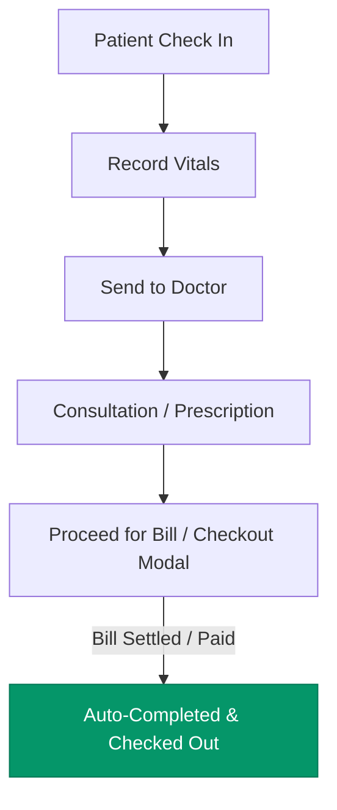

# Implementation Plan: Patient Registration, Default Views & Appointment Flow Refinements

**Target Modules:** Patient Registration & Directory, Doctor Roster Views, Appointment Queue & Billing Checkout  
**Documentation:** Implementation Blueprint for Middle Screen Review

---

## 1. Overview of Requested Changes

1. **Patient Registration Form:** Make **Date of Birth (`dob`)** a mandatory required field (with frontend UI validation, visual required asterisk `*`, and backend controller validation).
2. **Old Patients Menu (All Patients & Directory):** Show all patients by default in the **List View** across both the main directory and patient 360 views.
3. **Doctor Menu View Mode Toggle:** Fix the issue where selecting the **Grid Menu** view button does not properly highlight as active (synchronizing button active states and CSS styles).
4. **Appointment Flow Streamlining (Remove Manual Checkout Button):** 
   - Remove the manual "Check Out" button from the waiting stage after patient check-in.
   - Maintain the automatic checkout workflow: when the patient pays their bill via the billing modal or invoices payment endpoint, the appointment automatically transitions to `completed` / `checked_out`, completing the visit process without redundant manual intervention.

---

## 2. Proposed Changes & Technical Specifications



### Task 1: Mandatory Date of Birth in Patient Registration

#### UI & Forms:
- **New Patient Registration Modal (`app.openNewPatientModal` in `public/js/app.js`):**
  - Add red asterisk `<span class="required" style="color: var(--danger);">*</span>` to the Date of Birth label.
  - Add `required` attribute to `<input type="date" id="np-dob">`.
  - In `app.submitNewPatient()`:
    - Validate `if (!dob) { this.highlightField('np-dob', 'Date of birth is required'); hasError = true; }`.
    - Disallow submitting without selecting a valid DOB.
- **Inline Registration inside Appointment Booking Modal (`app.openBookAppointmentModal` in `public/js/app.js`):**
  - Add `required` to `#book-np-dob`.
  - In `app.saveBookInlineNewPatient()`:
    - Validate `if (!dob) { this.highlightField('book-np-dob', 'Date of birth is required'); hasError = true; }`.
- **Edit Patient Modal (`patientsComponent.openEditPatientModal` in `public/js/components/patients.js`):**
  - Verify `#ep-dob` is marked required and highlighted if empty upon save.

#### Backend Validation:
- **`src/controllers/patientController.js` (`createPatient` & `updatePatient`):**
  - Ensure `dob` is validated along with `full_name`, `gender`, and `phone`:
    ```javascript
    if (!full_name || !gender || !phone || !dob) {
      return res.status(400).json({ success: false, message: 'Full name, gender, phone number, and date of birth are required.' });
    }
    ```

---

### Task 2: Default "All Patients" Menu to List View

- **`public/js/components/patient-history.js`:**
  - Verify default `viewMode: 'list'`.
  - Ensure the toolbar switcher button correctly initializes with `#p360-view-list-btn` as `btn-primary` and `#p360-view-grid-btn` as `btn-outline`.
  - Ensure that upon first load (`loadPatientsList`), `this.renderGrid()` renders the dense list table view by default.
- **`public/js/components/patients.js`:**
  - Confirm standard table directory renders immediately on load without extra clicks.

---

### Task 3: Doctor Menu Grid/List View Mode Active Button Highlight Fix

#### Problem:
- In `public/js/components/doctors.js`:
  - When calling `doctorsComponent.setViewMode(mode)`, the DOM queries `.view-mode-toggle .view-mode-btn`.
  - If another component (e.g., Billing) also has `.view-mode-toggle`, or if button classes/styles get overridden by general button styles without scoped IDs or correct index matching, the grid button doesn't receive the `.active` class or its active CSS state isn't rendered clearly.
- In `public/css/styles.css`:
  - Multiple definitions for `.view-mode-btn.active` exist (lines 2079 & 2550) with conflicting backgrounds and box-shadows.

#### Fix:
1. Assign distinct IDs to doctor view buttons:
   - `<button id="doc-view-list-btn" class="view-mode-btn ...">`
   - `<button id="doc-view-grid-btn" class="view-mode-btn ...">`
2. In `doctorsComponent.setViewMode(mode)`:
   - Explicitly update `doc-view-list-btn` and `doc-view-grid-btn` with `.classList.toggle('active', mode === 'list')` and `.classList.toggle('active', mode === 'grid')`.
3. In `public/css/styles.css`:
   - Consolidate `.view-mode-btn.active` rules to ensure high specificity, clear contrast (green pill background with white text or distinct card style with active indicator), and support for both Light and Dark themes.

---

### Task 4: Remove Manual Checkout Button from Appointment Process & Ensure Seamless Auto-Checkout

#### Problem:
- When a patient is checked in (`status === 'waiting'`), the action buttons display:
  - `Record Vitals` and `Check Out` (manual exit).
- The user requested removing the redundant manual "Check Out" button that appears after check-in. The appointment flow should naturally guide the patient through:
  `Check In` ➔ `Record Vitals` ➔ `Send to Doctor` ➔ `Consultation` ➔ `Proceed for Bill` ➔ **Auto Checkout upon Bill Settlement**.

#### Fix:
1. **`public/js/components/appointments.js`:**
   - In `appointmentsComponent.render()` row renderer:
     - In `status === 'waiting'` when `!hasVitals`: Remove the `<button onclick="appointmentsComponent.directCheckOut(...)"> Check Out </button>`. Show ONLY `<button> Record Vitals </button>`.
2. **`public/js/components/dashboard.js`:**
   - In `dashboardComponent.render()` Today OPD Queue renderer:
     - In `status === 'waiting'` when `!hasVitals`: Remove the `<button onclick="appointmentsComponent.directCheckOut(...)"> Check Out </button>`. Show ONLY `<button> Vitals </button>`.
3. **Verify Complete Automatic Checkout Workflow:**
   - In `src/controllers/billingController.js` (`createInvoice` & `recordPayment`):
     - When payment is completed (`paymentStatus === 'paid'`) and linked to an `appointment_id`, it updates `appointments SET status = "completed", completed_at = NOW()`.
     - In `public/js/app.js` (`submitCheckoutBill`): When the bill is paid, toast confirms `"🎉 Patient bill settled & checkout completed successfully!"` and refreshes the queue, which now shows the visit as completed.

---

## 3. Files Impacted

| File | Changes |
| :--- | :--- |
| [public/js/app.js](file:///c:/AR_Works/G-Clinic/public/js/app.js) | Make DOB mandatory in new patient modal & inline booking modal; enforce DOB error highlighting. |
| [src/controllers/patientController.js](file:///c:/AR_Works/G-Clinic/src/controllers/patientController.js) | Require `dob` in `createPatient` and `updatePatient` backend endpoints. |
| [public/js/components/patient-history.js](file:///c:/AR_Works/G-Clinic/public/js/components/patient-history.js) | Ensure default list view and active list toggle button state on mount. |
| [public/js/components/doctors.js](file:///c:/AR_Works/G-Clinic/public/js/components/doctors.js) | Fix Grid/List view mode button active class toggle using unique element IDs. |
| [public/css/styles.css](file:///c:/AR_Works/G-Clinic/public/css/styles.css) | Consolidate `.view-mode-btn.active` styling for crisp, prominent highlighting. |
| [public/js/components/appointments.js](file:///c:/AR_Works/G-Clinic/public/js/components/appointments.js) | Remove manual "Check Out" button from waiting/check-in stage. |
| [public/js/components/dashboard.js](file:///c:/AR_Works/G-Clinic/public/js/components/dashboard.js) | Remove manual "Check Out" button from Today OPD Queue in waiting stage. |

---

## 4. Verification & Testing Plan

1. **Patient Registration DOB Check:**
   - Open Register Patient (`Alt + N`). Try saving without Date of Birth.
   - Verify red highlight appears with toast *"Date of birth is required"*.
   - Pick a birth date; verify calculated age updates automatically and form submits successfully.
   - Repeat for inline registration in Book Appointment modal.
2. **Default List View Check:**
   - Click "All Patients" menu.
   - Verify patients are immediately displayed in table list view, and the "List" toggle button is highlighted.
3. **Doctor View Mode Highlight Check:**
   - Go to Doctors menu.
   - Click "Grid". Verify Grid button is prominently highlighted and cards appear.
   - Click "List". Verify List button is prominently highlighted and table appears.
4. **Appointment Checkout Process Check:**
   - Book and check in a patient.
   - Verify the waiting row shows **Record Vitals** (without a manual Check Out button).
   - Record vitals ➔ Send to Doctor ➔ Doctor conducts consultation ➔ Proceed for Bill.
   - Collect payment in billing checkout modal.
   - Verify appointment automatically updates to completed/settled upon bill payment.
